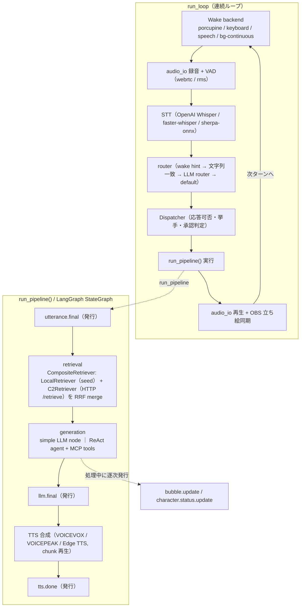

# aibyss-lab-lounge (L2)

A.I.byss Suite の **会話ランタイム**（港の現場を回す心臓部）。マイク音声やテキストを受け取り、
**STT → キャラクター・ルーティング → LLM → TTS** のパイプラインを実行し、その過程を
Event Bus (Redis Streams) に Event Envelope として publish する。複数キャラクターの協調、
挙手制の自発介入、MCP ツール、立ち絵連携 (OBS) までを束ねる。

> 深海×AI をテーマにした AITuber 配信を「反応するだけ」から「待ち感のない対話」へ。
> L2 は *崩れない配信体験* を支える低レイテンシ＆フォールバック重視のランタイム。

> **実装状況** (2026-05-25):
> - Walking Skeleton 〜 Real E2E 〜 Grounded E2E (RAG) — テキスト/音声エミッタ・real STT/LLM/TTS・seed corpus + C2 検索
> - **Axis A〜D** — マルチキャラクター・Porcupine ウェイクワード・意図ゲート・OBS 立ち絵・WebRTC VAD・C2 意味検索 (RRF merge)・フィラー・Agent 自律化 (LangGraph) + MCP ツール・faster-whisper
> - **Phase 0.5 系列** — 挙手制自発介入 (dispatcher 状態機械)・CharacterStatusManager (7 状態)・案 R リファクタ + dead code cleanup・bubble 3 系統分離・各種実走品質改善
> - テスト: 外部呼び出しはすべて mock（警告 0 維持）

関連リポジトリ: [C2 = aibyss-coral-chronicle](https://github.com/think-ai-lab/aibyss-coral-chronicle)（歴史書 / RAG）・[V2 = aibyss-nautilus-v2](https://github.com/think-ai-lab/aibyss-nautilus-v2)（HUD）・[aibyss-workspace](https://github.com/think-ai-lab/aibyss-workspace)（港 / 共通スキーマ）。

---

## アーキテクチャ



編集可能な詳細図（run_loop ループ・pipeline ノード・Dispatcher / CharacterStatusManager 状態機械）:
[`../aibyss-workspace/docs/diagrams/lab-lounge-internals.drawio`](../aibyss-workspace/docs/diagrams/lab-lounge-internals.drawio)
（draw.io / diagrams.net・VS Code draw.io 拡張で開ける）

---

## セットアップ

### 前提

- Python 3.11 以上
- [uv](https://github.com/astral-sh/uv) がインストール済み
- `aibyss-workspace` が兄弟ディレクトリに clone 済み（Event Envelope スキーマの自動探索に使用）
- `aibyss-workspace` で Redis が起動済み（`docker compose up -d`、本番実行時）
- Windows のスクリプト（`aibyss.ps1`, `run_dev.ps1`, `run_irodori_sidecar.ps1` など）は PowerShell 7（`pwsh`）で動かす。`run_dev.ps1` と `run_prod.ps1` は先頭の `#Requires` で 7.5 以上を求め、古い版なら版の違いを伝えて止まる（7.4 以前は空の値の環境変数を作れず、`REDIS_STREAM_KEY=` の検査が効かないため）。ほかのスクリプトは、5.1 が BOM のない UTF-8 を ANSI として読むので、日本語の Windows では構文エラーで止まる

```
repos/
  aibyss-workspace/          <- specs/event-envelope-0.1.schema.json, docker-compose.yml
  aibyss-lab-lounge/         <- このリポジトリ
  aibyss-coral-chronicle/    <- C2（購読・タイムライン API・RAG）
```

### インストール

```bash
cd aibyss-lab-lounge
uv sync                # 基本依存（.venv 自動作成）
uv sync --extra dev    # 開発用ツール（pytest 等）を含める
```

### optional extras

機能ごとに extra を追加する（複数同時指定可）。

| extra | 含まれるパッケージ | 機能 |
|-------|-------------------|------|
| `dev` | pytest, pytest-asyncio | テスト実行 |
| `llm` | langgraph, langchain-openai | real LLM（OpenAI）+ LangGraph |
| `llm-google` | langchain-google-genai | real LLM（Google Gemini） |
| `llm-anthropic` | langchain-anthropic | real LLM（Anthropic Claude） |
| `tts` | edge-tts, mutagen | real TTS（Edge TTS） |
| `stt` | openai | real STT（OpenAI Whisper API） |
| `stt-local` | faster-whisper | ローカル STT（faster-whisper, GPU 推奨） |
| `stt-sherpa` | sherpa-onnx | ローカル STT（sherpa-onnx） |
| `mic` | sounddevice, soundfile, numpy | マイク録音・スピーカー再生 |
| `rag` | openai, numpy | RAG（埋め込み生成 + ローカル検索） |
| `wake` | pvporcupine | Porcupine ウェイクワード検知 |
| `vad-webrtc` | webrtcvad-wheels | WebRTC VAD（発話検知） |
| `tools` | fastmcp, langchain-mcp-adapters, langchain-tavily | MCP ツール（Agent モード / Web 検索） |
| `obsws` | obsws-python | OBS WebSocket（立ち絵 pose/emotion 切替） |
| `obs` | langsmith | LangSmith トレーシング |

```powershell
# 配信フル構成（マルチキャラ + 挙手 + OBS + ツール）の一例
uv sync --extra llm --extra llm-google --extra llm-anthropic `
        --extra stt-local --extra mic --extra wake --extra vad-webrtc `
        --extra rag --extra tools --extra obsws
```

`uv sync` は指定しなかった extra を消すので、足すときは必要な extra をまとめて指定する。この節と各エントリポイントの `uv sync` は、その機能を動かすための組。[`preflight`](#4-preflight--配信前の点検) を流す環境は、全 extra を見るので `uv sync --frozen --all-extras` で入れる。

> **TTS の VOICEPEAK / VOICEVOX について**: VOICEPEAK は別途インストールし PATH を通すか
> `L2_TTS_VOICEPEAK_PATH` で指定する。VOICEVOX は Engine をローカル起動する
> （`docker run -d --name aibyss-voicevox -p 127.0.0.1:15021:50021 voicevox/voicevox_engine:cpu-0.26.0`）。
> ホスト側を 15021 にするのは、既定の 50021 が Windows の永続除外レンジに入り bind できないため。
>
> **irodori-TTS（ニューラル音声クローン / VoiceDesign）について**: torch + CUDA を使うため
> 別プロセスの HTTP サイドカーとして動かす（[`sidecar/README.md`](sidecar/README.md)）。起動は
> `aibyss-workspace/scripts/aibyss.ps1 start -Irodori` か `scripts/run_irodori_sidecar.ps1`（weights が未取得なら初回だけ `-AllowDownload` を付けて後者を流す）。
> provider は `irodori_vd`（VoiceDesign）。確定版は self-ref アンカー + caption + seed + sway24。
> どのキャラがどの provider を使うかは `characters.py` で定義する（確定版は ミミ/ちさめ/さくら/アルカ）。

### 環境変数

```bash
cp .env.example .env   # 既定値のまま動作する。秘匿値（API キー）は .env にのみ記載しコミット禁止
```

主要変数（全項目と詳細コメントは [`.env.example`](.env.example) を参照）:

| 変数 | 既定値 | 説明 |
|------|--------|------|
| `REDIS_URL` | `redis://127.0.0.1:6379` | Redis 接続 URL |
| `REDIS_STREAM_KEY` | `aibyss:events` | publish 先の Redis Stream キー（`run_dev.ps1` は未設定と空を拒否し、`run_prod.ps1` は空を拒否する。起動前の確認では、V2 と、検索に使う C2 のストリームと違えば止まる（検索に使わない C2 は黄色で知らせて続行）） |
| `L2_BUS_CONNECT_TIMEOUT_SEC` / `L2_BUS_SOCKET_TIMEOUT_SEC` | `0.5` / `1.0` | Redis への接続と XADD の応答を待つ上限（秒）。再試行はしない |
| `L2_BUS_RETRY_AFTER_SEC` | `5` | Redis に届かなかった後、接続を試さずにすぐ諦める時間（秒）。`0` で毎回試す |
| `L2_BUS_FAIL_OPEN` | `true` | `utterance.final` / `llm.final` / `tts.done` の publish が Redis の障害で失敗しても、ERROR ログを残して声を続ける。諦めた event は再送しないので、C2 の正史と V2 の HUD に穴が開く。`false` でそのターンを止める |
| `AIBYSS_SCHEMA_PATH` | *(自動探索)* | スキーマ絶対パス（省略で兄弟 workspace を探索） |
| `L2_USE_REAL_LLM` | `false` | `true` で real LLM を呼ぶ（ダミー応答を無効化） |
| `L2_LLM_PROVIDER` / `L2_LLM_MODEL` | `openai` / `gpt-5.4` | 既定プロバイダ・モデル（**フォールバック**。キャラ別の指定が `characters.py` にあればそちらが優先） |
| `OPENAI_API_KEY` / `GOOGLE_API_KEY` / `ANTHROPIC_API_KEY` | *(real mode 時)* | 各 LLM プロバイダの API キー |
| `L2_USE_REAL_TTS` | `false` | `true` で real TTS を呼ぶ |
| `L2_TTS_PROVIDER` | `voicevox` | 既定 TTS プロバイダ（`edge_tts` / `voicevox` / `voicepeak` / `irodori_vd`）。キャラ単位は `characters.py` で定義 |
| `L2_TTS_IRODORI_URL` | `http://127.0.0.1:18080` | irodori サイドカーの URL（[`sidecar/`](sidecar/README.md)） |
| `L2_IRODORI_VOICES_JSON` / `L2_IRODORI_READINGS_JSON` | `reference_voices/voices.json` / `…/readings.json` | irodori 設定の正典 / 読み辞書（読みが欠損でも動作） |
| `L2_USE_REAL_STT` | `false` | `true` で real STT を呼ぶ |
| `L2_STT_PROVIDER` | `faster-whisper` | STT プロバイダ（`openai` / `faster-whisper` / `sherpa-onnx`） |
| `L2_DEFAULT_SPEAKER` | `octamaid` | 既定キャラ slug（wake hint / 文字列一致なし時） |
| `L2_USE_LLM_ROUTER` / `L2_LLM_ROUTER_MODEL` | `true` / `claude-haiku-4-5` | LLM によるキャラ・ルーティング |
| `L2_USE_INTENT_GATE` / `L2_INTENT_GATE_MODEL` | `true` / `claude-haiku-4-5` | 挙手・承認の意図判定（軽量分類 LLM） |
| `L2_ENABLE_RAG` / `L2_USE_C2_RETRIEVER` | `false` / `false` | seed corpus RAG / C2 会話メモリ RAG（どちらも `retrieve_memory` ツールからしか呼ばれないので、`L2_ENABLE_TOOLS` が前提） |
| `L2_C2_URL` | `http://127.0.0.1:8100` | C2 のベース URL（RAG 参照先。`run_dev.ps1` / `run_prod.ps1` が起動前に `/health` を確かめる先でもある） |
| `L2_V2_URL` | `http://127.0.0.1:3200` | V2 のベース URL（`run_dev.ps1` / `run_prod.ps1` が起動前に `/health` を確かめる先。L2 本体は接続しない） |
| `L2_USE_HANDRAISE` | `true` | 挙手制自発介入の有効化（`bg-continuous` 上で動作） |
| `L2_ENABLE_TOOLS` | `false` | MCP ツール（Agent モード）の有効化 |
| `L2_VAD_BACKEND` / `L2_VAD_AGGRESSIVENESS` | `webrtc` / `3` | VAD バックエンドと感度 |
| `L2_OBS_WS_URL` / `L2_OBS_WS_PASSWORD` | *(任意)* | OBS WebSocket 接続情報（立ち絵切替）。host が loopback でなければ OBS は別の PC とみなし、起動前の確認で HUD への `ws_clients.lan` を見る |
| `LANGSMITH_TRACING` | `false` | `true` で LangChain/LangGraph 実行を LangSmith に送信 |

---

## キャラクター

`characters.py` で一元管理（環境変数の爆発を避け、キャラ固有設定はコードで定義）。
既定キャラは `L2_DEFAULT_SPEAKER`（既定 `octamaid`）。

| slug | 表示名 | ウェイクワード | LLM | TTS（ボイス） |
|------|--------|--------------|-----|--------------|
| `mimi` | ミミ・オクタヴィア | ミミ様 | OpenAI `gpt-5.5` | irodori VoiceDesign（mimi） |
| `chisame` | 波心ちさめ | ちさめさん | Google `gemini-3.1-pro-preview` | irodori VoiceDesign（chisame） |
| `sakura` | 八重笠さくら | さくらさん | Anthropic `claude-sonnet-4-6` | irodori VoiceDesign（sakura） |
| `octamaid` | オクタメイド | オクタメイド | 既定（OpenAI） | VOICEVOX（89 / Voidoll） |
| `ruka` | 坂東ルカ | *(なし)* | 既定（OpenAI） | VOICEPEAK（Frimomen） |
| `aruka` | アルカ（AIホスト） | アルカさん | 既定（OpenAI） | irodori VoiceDesign（aruka） |

VOICEPEAK に戻すには `characters.py` の該当キャラの `tts_provider="voicepeak"` ＋ `tts_voice`（Asumi Ririse / Miyamai Moca / Haruno Sora）を編集する。

各キャラのシステムプロンプトは `src/lab_lounge/system_prompts/` に配置。
irodori_vd キャラ（ミミ/ちさめ/さくら/アルカ）は **pose-only**：LLM 出力は `{speed, pose, response}` で、
pose → 本文末の正規絵文字 + caption 末尾サフィックス、speed → duration_scale に変換される
（声質は self-ref アンカー + caption + seed で固定。emotion は使わない）。
設定の正典は `reference_voices/voices.json`（`L2_IRODORI_VOICES_JSON`）でデータ駆動。
将来 VOICEPEAK を採用するキャラは `voicepeak_emotion_keys` を持ち emotion を出力する（機構は温存）。

### 読み辞書（readings）

irodori はエンジン側に読み上げ辞書 / g2p を**持たない**ため、英単語・略語・固有名詞を誤読する
（例: `JSON`→ジュウソン、`波心`→なみごころ）。そこで L2 が **「喋るテキスト」にだけ** 読み置換を
適用する（**HUD/字幕は元のまま** — 画面は「RAG」、音声は「ラグ」）。VOICEPEAK/VOICEVOX の
エンジン内辞書に相当する機能を L2 側で一元化したもの。

- **辞書本体**: `reference_voices/readings.json`（`L2_IRODORI_READINGS_JSON`）。voices.json と同居。
  - `global`: 表層 → カタカナ読み（全キャラ共通）。`characters.<slug>` で個別上書き可。
  - 置換は **longest-match-first**（`Think-AI Lab` を `Lab` より先に）。
  - **欠損しても動く**（補正なしで素通り）→ 削除すればロールバック。
- **編集**: `readings.json` の `global` に `"表層": "カタカナ読み"` を足すだけ。L2 再起動で反映。
- **文脈依存の多音字は対象外**（`方`=かた/ほう、`十分`=じゅうぶん/じっぷん 等）。素朴な置換では
  一方の読みを強制して他方を壊すため `_excluded_review` に隔離し**適用しない**（irodori に任せる）。
- **アクセント**: irodori はアクセント制御の入力を持たない（モデルが自動決定）。実測では
  通常文のアクセントは妥当（最小対 箸/橋 を区別）。`.vdc2` の accent は `_accent_meta` として
  inert 保持（VOICEPEAK 復帰 / 将来の対応モデル用）。
- **VOICEPEAK 辞書からの生成**: VOICEPEAK でエクスポートした `.vdc2`（JSON）から初期辞書を作れる:
  ```powershell
  uv run python scripts/import_vdc2_readings.py --vdc2 <export>.vdc2 --out reference_voices/readings.json
  ```

> **小数点を含む数字**: irodori は小数点 `.` を読めない（`GPT-5.5` / `Gemini Pro 3.1` 等が誤読）。
> 喋るテキストの小数を自動正規化する（`5.5`→「ごてんご」、`3.14`→「さんてんいちよん」。
> 整数部は数字のまま・小数点は「てん」・小数部は桁読み）。HUD は `5.5` のまま、辞書編集は不要（常時自動）。

> **短文の末尾幻聴**: irodori は短文の尺を過剰予測し、余尺を「それっぽい発話」で埋めることがある
> （「○○ですわ」のような語尾の反復）。L2 は短文（既定 ≤12 字）に **manual duration** を与えて
> 尺予測器をバイパスし抑制する。`L2_TTS_IRODORI_SHORT_CHARS` / `_SEC_PER_CHAR` / `_MIN_SEC` で調整可。

---

## 実行方法

L2 には配信を動かす 3 つのエントリポイントと、配信前の点検ツールがある。

### 1. `emitter` — 開発用エミッタ（テキスト / 音声ファイル）

テキスト or `--audio-file` を入力に 1 パスを流す。CI/手動検証向け。

```powershell
# ダミーモード（LLM/TTS/STT を呼ばず Redis に 3 イベントを publish）
uv run python -m lab_lounge.emitter "今日の天気を教えて"

# stream_id を固定したい場合
uv run python -m lab_lounge.emitter "テスト発話" --stream-id my-stream-002
```

real STT + real LLM + real TTS の最短手順（Redis + VOICEVOX 起動済み・`OPENAI_API_KEY` 設定済み）:

```powershell
uv sync --extra stt --extra llm --extra tts

$env:L2_USE_REAL_STT = "true"; $env:L2_USE_REAL_LLM = "true"; $env:L2_USE_REAL_TTS = "true"
$env:L2_TTS_PROVIDER = "voicevox"; $env:L2_TTS_VOICE = "89"; $env:L2_TTS_SPEAKER = "Voidoll"
uv run python -m lab_lounge.emitter --audio-file samples/q1.wav
Remove-Item Env:\L2_USE_REAL_STT, Env:\L2_USE_REAL_LLM, Env:\L2_USE_REAL_TTS, `
  Env:\L2_TTS_PROVIDER, Env:\L2_TTS_VOICE, Env:\L2_TTS_SPEAKER
```

出力に `utterance.final` / `llm.final` / `tts.done` の 3 イベントの `event_id` と `stream_id` が表示される。

### 2. `run_once` — 1 往復会話

1 回録音 → STT → LLM → TTS → デバイス再生までを 1 往復で実行する最小ランタイム（固定秒数録音）。

```powershell
uv sync --extra mic --extra stt --extra llm --extra tts
uv run python -m lab_lounge.run_once                    # 既定 5 秒録音
uv run python -m lab_lounge.run_once --record-seconds 10
uv run python -m lab_lounge.run_once --no-play          # 再生をスキップ
```

### 3. `run_loop` — ウェイクワード連続ループ（本番向け）

ウェイクワード検知 → 録音 → STT → ルーティング → Pipeline → TTS → 再生 を繰り返す。

```powershell
uv sync --extra wake --extra mic --extra stt --extra llm --extra tts --extra vad-webrtc

uv run python -m lab_lounge.run_loop                        # wake backend 自動選択
uv run python -m lab_lounge.run_loop --wake-backend porcupine   # 選択肢: porcupine / speech / sherpa / continuous / bg-continuous / keyboard
uv run python -m lab_lounge.run_loop --max-turns 1          # 1 ターンで停止（検証用）
uv run python -m lab_lounge.run_loop --no-play
```

> **wake backend**（`--wake-backend`）: `porcupine`（ウェイクワード、要 `L2_PORCUPINE_ACCESS_KEY` + `porcupine/*.ppn`）/ `speech`（発話で起動）/ `sherpa`（sherpa-onnx 連続認識）/ `continuous`（常時文字起こし + バッファ）/ `bg-continuous`（常時録音 + Dispatcher、応答中も録音継続。**挙手制介入はこのモードのみ**）/ `keyboard`（Enter 手動トリガー）。省略時は自動選択、`porcupine` のキー未設定時は `keyboard` にフォールバック。

#### dev プロファイルで起動する（`scripts/run_dev.ps1`）

本番履歴（`c2.db`）を汚さずに会話ループを試すための開発モード起動スクリプト。内部的には上記の `run_loop` を呼ぶだけだが、環境変数の読み込みと dev/prod 分離を自動で行う。

```powershell
.\scripts\run_dev.ps1                              # 既定: -WakeBackend continuous -MaxTurns 3
.\scripts\run_dev.ps1 -MaxTurns 0                  # 無制限（Ctrl+C で停止、prod と同仕様）
.\scripts\run_dev.ps1 -WakeBackend bg-continuous -MaxTurns 5
.\scripts\run_dev.ps1 -SkipHealthCheck             # C2 も V2 も置かない構成
```

実行の流れ:

1. **継承した接続先を外す** — 親プロセスから `ANTHROPIC_BASE_URL` などの LLM の接続先を継承していたら、名前を表示して外す（Claude Code などのツールから起動すると継承する）。`preflight` は自分の中でしか外さないので、残すと点検が緑でも `run_loop` は別の相手へ繋がる。
2. **環境変数の読み込み（ファイルが source of truth）** — `.env`（本番と共通の設定 = `OPENAI_API_KEY` / `L2_USE_REAL_LLM` 等を継承）→ `.env.dev`（dev 固有の上書き = ストリーム名・C2 URL）の順に読み込み、いずれも既存のプロセス環境変数を上書きする（過去実行の残値による事故を防ぐ）。
3. **分離値の確認表示** — `REDIS_STREAM_KEY` / `L2_C2_URL`（主）/ `L2_C2_URL_READONLY`（副）/ VAD 設定 / `OPENAI_API_KEY`（`set` / `unset` だけ）を出力。URL は `host:port` で表示し、loopback 以外の host は `[HOST]` に伏せる（起動の出力は貼られることがあるため）。
4. **分離違反の安全チェック** — `REDIS_STREAM_KEY` が本番 `aibyss:events`、未設定、空のどれか、または `L2_C2_URL` が本番ポート `8100` を指していたら **起動を中断**（`bus` は未設定を本番と読むので、行を書き忘れただけで dev 発話が本番 C2 に混入する。空の値は C2 にも HUD にも届かない）。`L2_USE_C2_RETRIEVER` が `true` でない場合は警告のみ。
5. **起動前の確認** — `preflight --static --profile dev` を流し、C2 と V2 の `GET /health` を確かめる。失敗はまとめて赤く出し、`exit 1` で止まる。
   - **読んでいるストリームの照合**: `/health` の `stream` を実効の `REDIS_STREAM_KEY`（未設定は `aibyss:events`）と比べ、違えば止まる。V2 のポートは dev と prod で同じなので、別のモードの V2 が残っていても 200 を返し、確認が緑のまま字幕と bubble が出なくなるため。`status` が `ok` なのに `stream` がないのは古いプロセスなので、これも止まる。`disabled` はバスを読んでいないので比べず、黄色で知らせて続ける。
   - **C2**: 検索の設定によらず読む（C2 は検索のフラグと無関係に全発話を記録するので）。`L2_ENABLE_TOOLS` と `L2_ENABLE_RAG` と `L2_USE_C2_RETRIEVER` がすべて有効（記憶の検索に使う）なら、問題があれば赤で止まる。検索に使わない設定なら、接続できない、503、`stream` が違うときも止めず、黄色で知らせる（発話は Redis に残り、C2 を戻せば追いつく。`reason=append_failing` でも、C2 は書けなかった発話を ack せずに読み直すので、DB を直せば追いつく）。L2 と V2 だけの構成もこの形で起動できる。
   - **V2 の画面の数**: V2 の行の `ws_clients` で OBS の画面が繋がっているかを読める。足りなければ黄色で知らせるが、OBS を後から起動することもあるので止めない。`L2_OBS_WS_URL` が別の PC を指すなら `lan` が 0 のとき（同じ機械で `/status` を開いていると `total` は 0 にならないため）、loopback か未設定なら `total` が 0 のときに知らせる。
6. **`run_loop` 起動** — `uv run --frozen --all-extras python -m lab_lounge.run_loop --wake-backend <WakeBackend> [--max-turns <MaxTurns>]` を実行（`--frozen` は配信の直前に解決器を走らせないため、`--all-extras` は lock の更新後に extra が古いまま残らないようにするため）。ループ本体（Wake → 録音 → STT → ルーティング → Pipeline → TTS → 再生）は冒頭の[アーキテクチャ](#アーキテクチャ)図のとおり。

| パラメータ | 既定 | 説明 |
|-----------|------|------|
| `-WakeBackend` | `continuous` | run_loop の `--wake-backend` に渡す（上記 6 種から選択） |
| `-MaxTurns` | `3` | 暴走防止のターン上限。`0` 以下なら `--max-turns` を渡さず **無制限** にする |
| `-SkipHealthCheck` | なし | C2 と V2 の `/health` の確認を省く（どちらも置かない構成のため）。`preflight --static` は省かない。C2 だけを置かない構成には要らない（上の黄色の知らせで起動する） |

本番は `scripts/run_prod.ps1`。値は `.env` だけを読み、同じ確認を `--profile prod` で流す（`-MaxTurns` の既定は `0`）。同じシェルで流した `run_dev.ps1` の残りが本番へ渡らないように、`.env.dev` にあって `.env` にない名前は `.env` を読む前に環境から外し、外した名前を灰色で表示する（`.env.dev` の値は読まない）。`REDIS_STREAM_KEY` は未設定なら既定の本番 `aibyss:events` へ向くので通し、`aibyss:events-dev` と空の値は拒否する。dev と prod を切り替えるとき、L2 は `aibyss stop`（`aibyss-workspace/scripts/aibyss.ps1 stop`）では止まらない。先に L2 の窓を Ctrl+C で止める。動いている V2 も止めてから起動する（ポートが同じなので、残っているとストリームの照合で止まる）。Stream Deck などから起動するときは `scripts/l2-start-dev.bat` / `scripts/l2-start-prod.bat` を使う（新しい窓を開き、エラーで終わっても窓が残る）。

**分離の保証**: このスクリプトで起動した L2 は `aibyss:events-dev` のみに XADD し、主 C2 = `http://127.0.0.1:8101`（dev・書き込み先）、副 C2 = `http://127.0.0.1:8100`（prod・read-only 参照）を使う。発話データは本番 `c2.db` に混入せず、過去の本番履歴は参照できる。`REDIS_STREAM_KEY` が本番の値、未設定、空のどれかなら起動しない。

**前提**:
- Redis 起動済み（`aibyss-workspace` で `docker compose up -d`）
- 開発 C2（port 8101 / `c2-dev.db` / `aibyss:events-dev`、`aibyss-coral-chronicle/scripts/run_dev.ps1`。検索に使わない設定なら、止まっていても黄色で知らせて起動する）と V2（port 3200、`aibyss-nautilus-v2/scripts/run_dev.ps1`。別の URL なら `L2_V2_URL` で指す）が稼働
- 本番 C2（port 8100 / `c2.db`）は過去の本番履歴を読むための副 C2 で、止まっていても起動できる。止まっている間は、検索のたびに副 C2 の分が `L2_C2_RETRIEVER_BUDGET_MS`（既定 600 ms）で打ち切りになり、本番の履歴なしで続く（`preflight --paid` の `c2/readonly` と `memory` は WARN）。本番 C2 を動かさない期間は `.env.dev` の `L2_C2_URL_READONLY` を空にすれば待たずに済む
- `.env.dev` を作成済み（`cp .env.dev.example .env.dev`）

### 4. `preflight` — 配信前の点検

L2 は配信を止めないために LLM の失敗を握りつぶして別の経路へ落とすので、SDK やモデルが壊れても声は出続け、挙手や協働だけが無音で消える。`preflight` は本番と同じ関数をフォールバックの内側で直接呼び、`None` や例外をそのまま FAIL にする。

```powershell
# 課金なし。実効モデル、キーの有無、uv.lock との版の一致、SDK の import、配信文脈の鮮度、OBS などを確かめる
uv run --frozen --all-extras --no-sync python -m lab_lounge.preflight --static --profile dev

# 少額の課金あり。本応答、router、filler、Tavily、埋め込み、C2 の検索、記憶の検索、協働を実際に 1 回ずつ流す
uv run --frozen --all-extras --no-sync python -m lab_lounge.preflight --paid --profile dev
```

**前提**:
- `uv sync --frozen --all-extras` で全 extra を入れておく。版の検査（`deps/uv.lock`）は全 extra を見るので、[`optional extras`](#optional-extras) や `run_loop` の節のように extra を選んで `uv sync` した環境では FAIL になる（`uv sync` は選ばなかった extra を消す）。`uv.lock` の `onnxruntime`（`stt-local`）には Intel Mac の wheel がないので、Intel Mac では全 extra を入れられず、この検査は通らない
- `--profile dev` は `.env.dev` でストリームを dev へ向ける（`cp .env.dev.example .env.dev`）。無いと `aibyss:events` へ向くので `--paid` は終了コード 2 で止まる

| 引数 | 説明 |
|------|------|
| `--profile dev\|prod` | 必須。読む env ファイル。`dev` は `.env` + `.env.dev`、`prod` は `.env` のみ。本番の起動前に dev を測る事故を防ぐため既定を持たない。`prod` は `--static` でも `L2_USE_REAL_LLM` と `L2_USE_REAL_TTS` が真でないと FAIL |
| `--allow-prod` | `--paid` で `aibyss:events` への書き込みを許可する（既定は拒否） |
| `--characters mimi,sakura` | 点検するキャラを絞る（既定は全キャラ。必須は mimi / chisame / sakura / octamaid で、残りは別枠）。`--paid` で必須キャラを外すと WARN を出し、配信前の合格には使えない |
| `--collab one\|all\|none` | `--paid` で流す協働の組。`one`（既定）は sakura から chisame への 1 組、`all` はプロバイダを一巡する 3 組。`none` は協働を流さない（配信前の合格には使えない） |
| `--no-pipeline` | `--paid` で Redis と TTS まで通す 1 ターンと協働を省く（配信前の合格には使えない） |
| `--trace` | `--paid` で LangSmith への送信を止めない |

| 終了コード | 意味 |
|-----------|------|
| `0` | 必須の経路がすべて PASS（WARN は含んでよい） |
| `1` | 必須の経路に FAIL がある。想定外のエラーで止まったときも 1（要約の代わりに `想定外のエラー` の行が出る） |
| `2` | 実行を拒否した（本番ストリームへの書き込み、`.env` による LLM 接続先の上書き） |
| `3` | 前提サービスがないので、課金する前に止めた |
| `64` | コマンドラインの誤り |
| `130` | Ctrl+C で止めた |

最後の行の `判定:` は同じ結果を言葉で示す（例: `判定: 合格 (exit 0)`）。課金の前に止まったときも、引数の誤りで止まったときも出る。流していない経路があると `判定: 合格 (exit 0)。ただし配信前の合格には使えません: characters` のように添える。

引数の省略形（`--all` や `--pa`）は受け付けない。`--all` が `--allow-prod` として通ると、本番ストリームの拒否が外れてしまうため。

**`--paid` の前提**: Redis、`L2_ENABLE_TOOLS` と `L2_ENABLE_RAG` と `L2_USE_C2_RETRIEVER` がすべて有効なら C2（`GET /health` が 200 を返すこと。ポートが開いているだけでは足りない）、必須キャラの TTS エンジン（irodori を使うキャラがいれば `aibyss.ps1 start -Irodori`、VOICEVOX）。`L2_USE_REAL_LLM` と `L2_USE_REAL_TTS` が真でないと、課金する前に止まる。`--no-pipeline` は Redis と TTS を前提にしないので、`L2_USE_REAL_TTS` を問わず、`tts/*` と `tts-config/*` の行は記録だけで合否に数えない。

**初回の少額の流し方**: 全キャラへ流す前に、1 キャラだけで LLM の経路を確かめられる。

```powershell
uv run --frozen --all-extras --no-sync python -m lab_lounge.preflight --paid --profile dev --characters octamaid --no-pipeline --collab none
```

Redis と TTS エンジンは要らない（`tts/octamaid` はエンジンがなければ `[FAIL*]` になるが、合否に数えない）。既定の設定なら、router、意図判定、filler、本応答を 1 回ずつ呼ぶだけで済む（`L2_ENABLE_TOOLS` や `L2_ENABLE_RAG` を有効にしていれば Tavily や埋め込みも 1 回ずつ流れる）。`.env` で `L2_USE_REAL_LLM=true` にし、`OPENAI_API_KEY`（本応答と filler）と `ANTHROPIC_API_KEY`（router と意図判定）を入れる。`L2_USE_LLM_ROUTER`、`L2_USE_INTENT_GATE`、`L2_USE_HANDRAISE` をすべて `false` にすれば、OpenAI のキーだけで流せる。`L2_ENABLE_TOOLS` も有効にして C2 を求める設定なら、上の前提のとおり C2 も要る（なければ `.env.dev` の `L2_USE_C2_RETRIEVER` を `false` にする）。必須キャラを外し、TTS も通さないので、配信前の合格には使えない。

TTS まで通すときは `--no-pipeline` を外す。irodori のアンカー音声（`voices.json` と参照音声）は公開していないので、第三者は VOICEVOX を使う `octamaid` で試せる（本応答と filler は OpenAI、TTS は VOICEVOX。router と意図判定の既定は Anthropic）。

**`--paid` が流さない経路**: 本応答が FAIL のキャラは `pipeline` を `SKIP` にします。同じ Agent を通すので情報が増えず、壊れた応答が続くと待ち時間と課金だけが増えるためです。呼び出し側の本応答が FAIL なら、その組の協働も同じ理由で `SKIP` にします。`L2_ENABLE_TOOLS` が無効なら本番は `ask_character` を使わないので、協働も `SKIP` にし、`tools` の WARN で配信前の合格に使えないと知らせます。同じく本番は `retrieve_memory` も使わないので、`embeddings`、`c2`、`memory` も `SKIP` にして課金しません（`L2_ENABLE_RAG` だけが真なら `--static` が「RAG は効きません」と `WARN` で知らせます）。ほかに、ルーティングの対象外の `pipeline/ruka` は常に `SKIP`、別枠のキャラの TTS エンジンが落ちていれば `pipeline` を `SKIP`、無効なフラグの経路（router、filler、Tavily、埋め込み、C2）も `SKIP` です。

**`memory` の行**: 本番の `retrieve_memory` を、本番の組み立てと予算（`L2_C2_RETRIEVER_BUDGET_MS`、既定 600 ms）で 1 回流します。埋め込み 1 回分（C2 が有効なら C2 側の埋め込みも 1 回分）の課金が増えます。エラー文が返るか seed の検索が例外になると `FAIL`、C2 の打ち切りや HTTP エラーは `WARN` です（理由と ms を出します。1 回の遅さでは止めません）。戻り値は実発話を含むので、ms と件数と出どころの内訳だけを表示します。`c2` の行は 5 秒待って `search_mode` を見るだけなので、予算切れは `memory` でしか見えません。seed の索引（`L2_KB_PATH`、既定 `./data/index`）を読めないことは `--static` の `rag/index` で課金の前に分かります（未構築なら `scripts/build_index.py`）。埋め込みは OpenAI 固定なので、`--characters` で OpenAI のキャラを外しても `OPENAI_API_KEY` を確かめます。

**`--paid` の副作用**: dev ストリームへ `preflight-<時刻>` の `stream_id` で publish するので、dev の C2 と V2 の HUD に点検の発話が入り、以後の dev の記憶にも混ざりうる。`data/audio/` に WAV が残る（gitignore 済み）。音は鳴らさず、OBS の立ち絵も切り替えない。`--allow-prod` を付けると、これらが本番の正史に恒久的に残る。`L2_DEBUG_ARTIFACTS` と LangSmith への送信は止めて流し、本番で有効なら `flag/*` の行に「この実行では止めています」と出す。

**期待される出力（抜粋）**:

```text
[PASS ] deps/uv.lock: 147 件が lock と一致
[INFO ] model/mimi: main=openai:gpt-5.5 filler=gpt-5.4-mini
[PASS ] key/openai: set
[INFO ] url/REDIS_URL: loopback:6379
[WARN ] stream_context: data/stream_context/current.md は 2026-05-24 更新（160 日前）。今日の話として全キャラの prompt に入ります
[FAIL*] filler/ruka: gpt-5.4-nano: None が返りました (空応答)
[PASS ] memory: 412ms docs=5 c2=2 c2-recent=1 seed=2
[PASS ] main/mimi: gpt-5.5 7.9s api=chat source=structured_response in=13980 out=210 steps=1 called=-
[SKIP ] pipeline/ruka: ルーティングの対象外
[PASS ] collab/sakura->chisame: claude-sonnet-4-6 21.4s steps=2 called=ask_character_tool chunks=2

PASS 36 / FAIL 1 / WARN 2 / SKIP 1 / 本応答の tokens in=52310 out=840
  FAIL（別枠） filler/ruka
判定: 合格 (exit 0)
```

`api=` は応答が通った API（OpenAI は `chat` か `responses`、他はプロバイダの名前）。`called=` はモデルが呼んだツールで、渡したツールではない（構造化出力の受け取りに使うものは除く）。

`[FAIL*]` の行と要約の「（別枠）」は、終了コードに影響しない FAIL の印で、配信に出ないキャラ（ruka / aruka）などに付く。要約の下に並ぶ `FAIL` が、印のないものを含めて今回の失敗の一覧。

出力は配信中のコンソールや記録に貼られることがあるので、API キーは `set` / `unset` だけで、値、発話本文、接続先の host は表示しない（loopback の `127.0.0.1` などは調査の手がかりなので残す）。API の応答やモデルの出力に由来するエラーも、画面には型と status、短い `type` / `code` / `param` だけを出し、全文は `logs/preflight/`（gitignore 済み）に残す。手元の例外も、文言に載った相手の応答は切り、URL は `<URL>`、設定された接続先の host は `[HOST]`、ホームのパスは `~` と表示する。

**トラブルシュート**:
- `deps/uv.lock` が FAIL: extra を選んだ `uv sync` や素の `uv sync` で、残りの extras が消えている。`uv sync --frozen --all-extras` で直る
- `tts-config/<キャラ>` が FAIL: `L2_IRODORI_VOICES_JSON` の `voices.json` がないか、voice が未登録か、参照音声がないか、JSON の形が違う。既定の場所と `.env.example` の値は作者の環境のものなので、自分の `voices.json` を指す。全文は `logs/preflight/` に残る。LLM の経路だけ確かめるなら `--no-pipeline` で流せる
- 終了コード 2 で `aibyss:events へ書き込むので止めました`: `--profile dev` なら `.env.dev` がないか `REDIS_STREAM_KEY` の誤り。`--allow-prod` は本番の正史へ書くので、dev の点検で付けない
- `stream_context` が FAIL: `current.md` が UTF-8 以外で書かれている（PowerShell 5 の `>` など）。本番も起動時に同じ理由で落ちるので、UTF-8 で書き直す
- `obs` が FAIL: `L2_OBS_WS_URL` の形が不正（port が数字でないなど）。接続の失敗は WARN だが、この形だと本番は起動できない
- `flag/<設定名>` や `url/<設定名>` の値が読めない: 今の設定で本番が読むものは FAIL、読まないものは WARN（値は表示しない）。`flag/L2_VOICEPEAK_*` のように配信に出ないキャラだけが使うものは `[FAIL*]`
- `env/quoting` が WARN: ダブルクォートの中の `\r` や `\v` が制御文字に変わっている。`python-dotenv` と `run_*.ps1` で読み方が違うので、パスは引用符を外して書く
- `run-script/*` が WARN: `run_dev.ps1` / `run_prod.ps1` が起動を拒否する組（dev で `.env.dev` がない、dev で `L2_C2_URL` が `:8100`、prod で `:8101`）
- `env/proxy` が WARN: `HTTP_PROXY` か `ALL_PROXY` があり、`NO_PROXY` に `127.0.0.1` がない。`HTTP_PROXY` なら C2 の検索と TTS の接続がプロキシを通る。`ALL_PROXY` だけなら C2 の検索の接続だけが通る（TTS の `urllib` は `ALL_PROXY` を読まない）。`run_dev.ps1` / `run_prod.ps1` の `/health` の確認はプロキシを通らないので、確認だけが緑で本番が繋がらないことがある。`NO_PROXY=127.0.0.1` を足す
- `obs` が WARN で「立ち絵（`<slug>_neutral`）がありません」: グループがあっても、中のソース名が `<slug>_<pose>` でないと立ち絵は切り替わらない。接続の失敗の理由は `logs/preflight/` に残る
- `schema` が FAIL: Event Envelope のスキーマが見つからない。`aibyss-workspace` を兄弟に clone するか、`AIBYSS_SCHEMA_PATH` でスキーマのファイルを指す。本番はダミー起動でも全ターンが落ちる
- `persona/<slug>` が FAIL: 人格のファイルが空か UTF-8 以外。空なら人格なしで応答し、UTF-8 以外ならそのキャラのターンがすべて落ちる
- `tts-config/readings`: FAIL は `L2_IRODORI_READINGS_JSON` の辞書が壊れている（JSON の誤り、UTF-8 以外、読みが文字列でない）状態で、irodori の発話が落ちる。WARN は辞書がないか空の状態で、声は出るが英単語や固有名詞を誤読する
- `filler-cache` が WARN: opener の WAV がなく、応答を待つ間が無音になる。WAV は git に入らないので、新しい環境では TTS エンジンを起動して `uv run --frozen --all-extras --no-sync python scripts/generate_filler_cache.py` を一度流す
- `mode/L2_NO_PLAY`: 真だと音声を一切再生しない。`--profile prod` では FAIL、`dev` では WARN
- `url/L2_TTS_VOICEVOX_URL` が WARN: 末尾の `/` は外す（本番は `//audio_query` へ送る）。`50021` の警告は Windows だけで、macOS / Linux では VOICEVOX の既定のまま使える
- `pipeline` が WARN: 1 ターンの中で本番が握りつぶした警告があった（記憶の検索や bubble の発行など）。ERROR のログがあれば FAIL になる。行には件数だけを出すので、全文は `logs/preflight/` で読む
- `pipeline` が FAIL で「音声の長さが 0 です」: TTS エンジンが空の音声を返している。本番の合成は例外にならないので、声が出ないまま 1 ターンが終わる
- `tavily`、`embeddings`、`memory`、`pipeline` の `TimeoutError: <秒>s を超過`: 相手が応答を止めている。timeout のない経路なので、点検の壁時計で打ち切る（Tavily と埋め込みは 30 秒、1 ターンは 420 秒）
- `model/collab-override` が WARN: `L2_ASK_CHARACTER_MODEL_OVERRIDE` があると、キャラの設定によらず協働先は全員 `L2_LLM_PROVIDER` のこのモデルを使う。意図した設定でなければ消す
- `uv run` の `--no-sync` を外すと、実行前の同期で壊れた環境が黙って直り、版の検査が意味を失う
- `import/anthropic` が FAIL で版は一致している: Windows のパス長の上限。anthropic は名前の長いファイルを含むので、`LongPathsEnabled` が無効なら venv のパスは約 126 文字以内に収める（anthropic 0.125 以降の目安。今の lock の 0.89 なら約 154 文字）
- 終了コード 3 で `C2`: C2 の `/health` が 200 を返していない。起動していないか、Redis を読めていないか（consumer が止まると listen したまま 503 を返す）、DB に書けていない（`reason=append_failing`）。C2 の README の `/health` の節で理由を読める
- 終了コード 3 で `irodori`: `aibyss-workspace/scripts/aibyss.ps1 start -Irodori` で起動する（weights が未取得なら先に `scripts/run_irodori_sidecar.ps1 -AllowDownload` を 1 度流す）
- ツールから起動すると `ANTHROPIC_BASE_URL` などを継承するが、点検は外してから流し、`env/inherited` の WARN で外した変数名を知らせる。同じシェルから `python -m lab_lounge.run_loop` を直接起動すると継承したまま動くので、接続先や認証が変わる（`run_dev.ps1` / `run_prod.ps1` は外してから起動する）
- `.env` がそれらの接続先を指定していると終了コード 2 で止まる（本番と別の相手を測らないため）

**確かめないもの**: マイク、音声の再生、OBS の表示は人の確認が要る。STT（`L2_USE_REAL_STT` の経路とモデルの読み込み）、ウェイクワード、VAD、挙手の状態機械は流さない。C2 への書き込みと V2 の受信も確かめない（publish までを見る）。協働は既定で 1 組だけで、2 人目への連続した振りは通らない。

### 5. 計測の道具 — リプレイ、probe、c2_probe、spend

モデルや SDK、設定を変えたときに、「判定が変わったか」「速さと費用が変わったか」を数字で言うための道具です。
どれも配信の本流から呼ばれず（消しても配信の挙動は変わらない）、`python -m lab_lounge.<名前>` で流します。
**有料の道具（LLM を呼ぶもの）は、`--max-usd` で上限を渡し、送る前の見積もりが上限を超えるなら 1 件も送らずに止まります。**
見積もりは多め（入力は本文の bytes / 2 tokens、出力は最大出力まで出たとみなす）なので、`--max-usd` は「予約が 1 回分は入る余裕」を持たせて決めます
（足りないと、実際には余っていても次の 1 回を送る前に止まります）。1 回分の目安は、`probe agent` が始めに画面へ出す「予約の目安」（キャラごとのモデルの
最大出力 × 出力単価）。Agent は 1 回の呼び出しで複数の step を送るので、全体の見込みは「予約の目安 × step 数 × 呼び出し数」より低く収まります。
止まった回（上限、Ctrl+C など）も、`meta.json` に状態（`status`）と、そこまでの集計が残ります。同じ名前では流し直せないので、別の `--label` で流します。

| 道具 | 測るもの | 課金 |
|---|---|---|
| `spend` | 価格表と、支出の記録（`data/probe/spent.json`）の要約 | なし |
| `replay_set` / `replay` | 判定（挙手の候補、承認、呼びかけと言及、複数名の振り分け）の答えの変化 | あり |
| `probe raw` | 判定と filler の LLM 呼び出しの時間（p50 / p90 / 最大）、失敗、tokens、費用 | あり |
| `probe agent` | 本番と同じ Agent の全体の時間、step ごとの時間と tokens（キャッシュの読み書きを含む）、道具の発火、費用 | あり |
| `probe history` | 過去の実走ログの、キャラごと・月ごとの Agent の時間（数字だけ） | なし |
| `c2_probe latency` | C2 の検索の時間の分布（cold / warm）としきい値を超えた割合、予算の目安 | C2 側の埋め込みのみ |
| `c2_probe timeouts` | 過去の実走ログの C2 のタイムアウトを、月ごと・日付の前後ごとに数える | なし |

**出力の約束**: 画面と、`data/probe/` `data/replay/` の数字のファイルには、発話の本文も、モデルの答えも出しません（件数、率、時間、tokens、費用、決まった形の判定の答えだけ）。
本文やモデルの出力を含みうるファイルは、それぞれの `private/` に分けて置きます（`data/replay/private/`: リプレイのセット、確認のファイル、生の答え、WARNING のログ。`data/probe/private/`: Agent の返答の本文、WARNING のログ、配信文脈の写し）。
`private/` は人だけが開くフォルダです。Claude などの自動化には、`private/` を開かせず、直下の数字のファイルだけを読ませてください。
モデルの返答の本文は、聴き比べ用に `probe agent` の `data/probe/private/agent_<名前>.jsonl` だけに書きます（直下の `agent_<名前>.metrics.jsonl` は同じ行から本文を除いたもの）。`data/` は gitignore 済みで、実の配信ログから作ったものを含むので、そのまま共有しないでください。
実走ログ（`logs/runs/`）には発話が入っているので、集計の道具は先頭の形だけを読み、本文は読みません。

**流す前に**: `src/lab_lounge/measure_sets/` の合成の行（リプレイの期待値つきの行、計測の発話、C2 の問い合わせ）を、自分の公開してよい文面で用意します（`probe` と `c2_probe` は、無ければ何も送らずに断ります。`replay` は、無ければ合成の行なしで流します）。

```bash
# 価格表（出典の URL と確認日つき）と、支出の記録
uv run --frozen --all-extras python -m lab_lounge.spend prices
uv run --frozen --all-extras python -m lab_lounge.spend show
```

**判定のリプレイ**（モデルや判定の変更の前後で、答えが変わった行を数える）:

```bash
# 1) 実走ログから、過去の発話の固定のセットを組む（画面は件数だけ。--dry-run で数えるだけ）
uv run --frozen --all-extras python -m lab_lounge.replay_set build
#    data/replay/private/review.md の、外したい行の行頭を [x] にしてから
uv run --frozen --all-extras python -m lab_lounge.replay_set exclude

# 2) 少数で単価を確かめてから、基準の回を 2 回流す
uv run --frozen --all-extras python -m lab_lounge.replay run --profile dev --label canary --canary 5 --reps 1 --max-usd 0.05
uv run --frozen --all-extras python -m lab_lounge.replay run --profile dev --label base --reps 2 --max-usd 1.0

# 3) 変更の後に同じセットを流し、基準と比べる。違う行だけを確認のファイルへ書き、印を付けて採点する
uv run --frozen --all-extras python -m lab_lounge.replay run --profile dev --label after --reps 1 --max-usd 1.0
uv run --frozen --all-extras python -m lab_lounge.replay compare --base base --run after   # 承認の反転があれば終了コード 1
uv run --frozen --all-extras python -m lab_lounge.replay review  --base base --run after
uv run --frozen --all-extras python -m lab_lounge.replay score   --base base --run after
```

**速さと費用**（`probe`。LLM の呼び出しは `--max-usd` の上限つき）:

```bash
# まず 1 キャラ 1 本で、道具の欄、モデル、費用を確かめる
uv run --frozen --all-extras python -m lab_lounge.probe agent --profile dev --label canary --characters mimi --limit 1 --max-usd 0.2

# 判定と filler（6 グループ × n=30）、Agent（4 キャラ × 計測の発話、呼び出しの間 2 秒）
uv run --frozen --all-extras python -m lab_lounge.probe raw   --profile dev --label baseline --max-usd 1.0
uv run --frozen --all-extras python -m lab_lounge.probe agent --profile dev --label baseline --max-usd 3.0

# 過去の実走ログの月ごとの時間（課金なし。数字は data/probe/history_<名前>.json にも書く）
uv run --frozen --all-extras python -m lab_lounge.probe history --label past
```

- `probe agent` は、本番の組み立て（人格、配信文脈、日時の system prompt、道具のスキーマ）のまま、道具だけを長さを固定した定型の応答に差し替えます（外の検索や記憶、他キャラの発話を呼ばないので、本応答の LLM の時間だけが測れます）。
  配信文脈は最初の回の写し（`data/probe/private/stream_context_snapshot.md`）を、後の回も使います。取り直すなら `--refresh-snapshot`。`L2_ENABLE_TOOLS` が無効だと、本番は Agent を通らないので断ります。
- 時間切れ（`L2_AGENT_INVOKE_TIMEOUT_SEC`）に当たったら、記録してからプロセスごと終えます（取り残したスレッドの課金を止めるため）。`agent.invoke` の中（SDK など）が自分で投げたタイムアウトは、普通の失敗として記録して続けます。
- 全体で 30 分ほどかかるので、キャラ（と `raw` のグループ）は、発話の番号ごとに交互に流します（API の混み具合の変化が後のキャラに偏らないように）。`cold` はキャラごとの 1 本目で、DNS や TLS を払うプロセスの最初の呼び出し、提供元ごとの最初の呼び出しには、別に `first_in_process` / `first_for_provider` の印が付きます。
- tokens の入力は 2 つの名前で区別します: `in_total`（キャッシュの読み書きを含む合計。LangChain の `input_tokens` と同じ意味）と `in_uncached`（キャッシュに当たらなかった入力。Anthropic の `input_tokens` と同じ意味）。`cache_read` / `cache_creation` と並べて、キャッシュの効果を比べます。usage を拾えない提供元が 1 社でもあれば、止まります（提供元ごとに確かめています）。

**食べ比べ**（後継のモデルを、同じ発話で比べる流れ）:

1. 基準の回を流しておく（上の `baseline`）。
2. 新しいモデルを 1 行で足して、同じ発話で `agent` を流す。`--llm provider:model` で、4 キャラ全員をそのモデルに差し替えられます。モデルが価格表（`spend prices`）に無ければ、送らずに止まるので、先に価格を確かめて表へ足します（一時的な上書きは `--price model=入力,出力[,キャッシュ読み[,キャッシュ書き]]`、使ったことは記録に残ります）。
   ```bash
   uv run --frozen --all-extras python -m lab_lounge.probe agent --profile dev --label try_new --llm anthropic:<新しいモデル> --max-usd 3.0
   ```
3. `data/probe/agent_baseline.metrics.jsonl` と `agent_try_new.metrics.jsonl`（数字だけ）で、step ごとの時間、tokens、`cache_read` / `cache_creation`、費用を比べる。画面にもキャラごとの cold / warm の p50 / p90 と費用が出ます。
4. 声の聴き比べは、`private/agent_<名前>.jsonl` の返答の本文を、同じ発話 id で並べて読む（本文はここにだけあります）。
5. 判定（挙手の候補と承認）のモデルを変えるときは、`replay` の基準と比べて反転が 0 であることも見る。

**C2 の検索の時間**:

```bash
# 前提: C2 を起動しておく（この道具は起動しない）。最初に /health を見て、届かなければ何も送らず終了コード 3
uv run --frozen --all-extras python -m lab_lounge.c2_probe latency --profile dev --label first
# 過去の実走ログのタイムアウト。2026-10-31（接続先を 127.0.0.1 に直した日）の前後も分ける
uv run --frozen --all-extras python -m lab_lounge.c2_probe timeouts --label past
```

- `latency` は、本番の retriever と同じ形の要求（`GET /retrieve?q=..&k=..`、`GET /retrieve/recent?k=..`、リクエストごとに新しい接続）を、`L2_C2_URL`（と、あれば `L2_C2_URL_READONLY`）へ送ります。読むだけです。時間切れは 10 秒と長めにして分布を見ます。1 周目を cold、2 周目以降を warm とし、warm の p99 を収める最小の値（100 ms 刻み）を予算の目安として出します（失敗は時間切れまで待った 1 件として数え、warm の失敗が 1% を超えるときは目安を出さずに理由を出します）。`localhost` と `127.0.0.1` の比べは別の問いなので `host_compare` と呼びます。送り先が loopback でなければ、ホスト名は画面にも meta にも出さず `remote` とポートだけにします。本番の設定に合わせて、`L2_USE_C2_RECENT` が true でない、または `L2_C2_RECENT_SCOPE=session` のときは `/retrieve/recent` を測らず（理由を出します）、`L2_USE_C2_RETRIEVER` が true でなければ、本番は C2 を使わないと警告します。
- `timeouts` の分母は検索の呼び出し数、分子は retriever ごとのタイムアウトの行数なので、比は確率ではありません（出力の注記にも書いてあります）。Agent が 1 度も答えなかった回（最も悪い回）も含め、含めた本数を注記に出します（`probe history` も同じ）。

**終了コード**（`probe` / `c2_probe` / `replay`）: 0 正常、1 失敗（呼び出しの失敗、時間切れ、承認の反転）、2 断った（同じ名前の回がある、入力が無い、ツールが無効）、3 前提サービスなし（`c2_probe latency` の /health）、4 上限・価格表にないモデル・usage の拾い損ねで止めた、64 コマンドラインの誤り。

**補助の道具**: `tests/bench_ttft.py` は、モデルを切り替えるときの TTFT の目安を見る道具で、採否の根拠にしません（Agent を通さない短いプロンプトだけを測ります）。Claude のモデルには temperature を送らず、`[skip]` を含む失敗が 1 つでもあれば終了コード 1 で終わります。

---

## 主要サブシステム

- **キャラクター・ルーティング** (`router.py`) — wake hint → 文字列一致 → LLM router（`L2_USE_LLM_ROUTER`）→ default の優先順で担当キャラを決定。
- **挙手制自発介入 / Dispatcher** (`dispatcher.py`) — `bg-continuous` 上で「呼ばれていないが自分の関心領域に触れた」発話に対しキャラが自発的に挙手し、ルカが承認/却下する。状態機械は IDLE / RESPONDING / HANDRAISING。承認/却下/lapse（既定 300 秒）で解消し、`bubble.update`（raisehand 系）と `dispatcher.*` イベントで HUD に可視化。`L2_USE_HANDRAISE` で on/off。
- **CharacterStatusManager** (`character_status.py`) — 全キャラの内部状態を 7 値（READY / THINKING / TOOL_CALLING / RAISEHAND / RAISEHAND_PROGRESSING / RAISEHAND_READY / TALKING）で一元管理。変化時に `character.status.update` を発行し、V2 の `/status` dashboard が可視化する。
- **Agent モード / MCP ツール** (`graph.py`, `mcp_servers/`) — `L2_ENABLE_TOOLS=true` で LangGraph の ReAct エージェントが `ask_character`（他キャラへ質問）/ `web_search`（Tavily）/ `retrieve_memory`（C2 会話メモリ）を呼ぶ。
- **Retriever** (`retriever.py`) — `LocalRetriever`（seed corpus を numpy コサイン類似度で検索）/ `C2Retriever`（C2 の `/retrieve` を HTTP で叩く）/ `CompositeRetriever`（両者を RRF でマージ）。`L2_ENABLE_RAG` / `L2_USE_C2_RETRIEVER` で構成。
- **フィラー** (`filler.py`) — 「えーっと」等のつなぎ発話を事前生成・キャッシュし、LLM 応答までの沈黙を埋める。VOICEPEAK キャラは emotion 付き。
- **OBS 立ち絵連携** (`obs.py`) — OBS WebSocket でキャラの pose/emotion ソースを切り替え、発話タイミングと同期。
- **VAD（発話検知）** (`audio_io.py`) — WebRTC VAD（推奨、`aggressiveness` 0–3）または RMS 閾値方式。
- **配信文脈** (`stream_context.py`) — 「今日の配信内容」を全キャラのシステムプロンプトに重ねる（下記参照）。

---

## 発行イベント

L2 はすべて Event Envelope (v0.1) でラップし、publish 前にスキーマ検証する（`stream_idx` は付与しない = Guardrail G-1）。

| type | 用途 | 主な consumer |
|------|------|--------------|
| `utterance.final` | STT 確定テキスト（lang / confidence / words） | C2（正史保存） |
| `llm.final` | LLM 応答（model / token / latency / RAG メタ / character） | C2 |
| `tts.done` | 音声合成完了（audio_url / duration / voice / character） | C2・V2（→ hud.caption） |
| `bubble.update` | 進捗・挙手の吹き出し（category: speech_status / speech_content / raisehand） | V2（OBS 吹き出し） |
| `character.status.update` | キャラ内部状態（7 状態 + metadata） | V2（`/status` dashboard） |
| `dispatcher.queue.update` | wake_event キュー状態（運用デバッグ用） | V2（デバッグ HUD） |
| `dispatcher.handraise.update` | 挙手中キャラ + 連続却下 cooldown（運用デバッグ用） | V2（デバッグ HUD） |

links による因果: `llm.final.links = [utterance.final.event_id]`、`tts.done.links = [llm.final.event_id]`。

---

## 配信文脈のカスタマイズ

「今日の配信内容」を別ファイルで管理し、全キャラのシステムプロンプトに `## 本日の配信` として
重ねる仕組み。起動時（`run_loop` / `run_once` / `emitter`）に 1 度だけ読み込む。

最終的に LLM へ渡るシステムメッセージは 3 層構造:

```
<キャラ素体 system_prompt>     ← 不変・人格基盤
## 本日の配信                  ← 配信単位の前提（stream_context）
## 参照情報                    ← ターン毎に変わる動的情報（RAG）
```

`data/stream_context/` 配下の実ファイルはすべて gitignore 対象（個人メモや配信外情報を含みうるため）。
構造を伝える `current.example.md` のみ commit する。

| ファイル | git 管理 | 用途 |
|---------|---------|------|
| `current.example.md` | commit | 構造を伝えるテンプレ |
| `current.md` | gitignore | 「起動時に読まれるファイル」を指す一時参照 |
| `yyyymmdd_NN.md` | gitignore | 配信単位の本体（予定/archive） |

```bash
# 日付ベースのファイルを直接参照（current.md コピー不要・推奨）
echo "L2_STREAM_CONTEXT_FILE=./data/stream_context/20260506_01.md" >> .env
```

> 配信中の編集は反映されない（再起動が必要）。未存在/空ファイル時は配信文脈なしで動作（後方互換）。

---

## トラブルシューティング

- **TTS プロバイダ選択**: 標準は `voicevox`（WAV 出力で `soundfile` 再生可）。`edge_tts` は MP3 出力で `soundfile` が非対応のため、再生を伴わないバッチ生成向け。再生したい場合は `voicevox` か `voicepeak`。
- **無音検知で中断する**（RMS バックエンド時）: `L2_SILENCE_THRESHOLD` を下げる（静かな環境 0.001–0.003 / 騒がしい環境 0.005 以上）。`scripts/calibrate_silence.py` で計測可。WebRTC VAD（既定）はキャリブレーション不要。
- **別のマイク/スピーカーを使う**: `uv run python -c "import sounddevice; print(sounddevice.query_devices())"` で番号を確認し `--device N` または `L2_AUDIO_DEVICE` を指定。
- **VOICEPEAK が並列実行エラー/クラッシュ**: 1 プロセス制限のためフィラーと本応答が衝突しうる。`L2_VOICEPEAK_RETRY_WAIT_SEC` / `L2_VOICEPEAK_MAX_RETRIES`（既定 1.0s × 8 回）で自動リトライ。
- **LangSmith 401 警告**: `.env` に `LANGSMITH_TRACING=false` を明示する（`langsmith` は `langgraph` の依存として入る）。
- **`run_dev.ps1` / `run_prod.ps1` が起動前の確認で止まる**: `接続できません` はサービスが起動していない。`HTTP 503` は起動しているが Redis を読めていない（C2 は `reason=consumer_stale` など、V2 は `redis.sub` と `consumer` に理由が出る）。C2 の `reason=append_failing` は、Redis は読めているが DB に書けていない印。原因（DB の読み取り専用、ディスク不足、ロックなど）を取り除く。C2 は書けなかった発話を ack せずに待って読み直しているので、原因が消えれば再起動しなくても続きから追いつき、503 も消える（C2 の README の `/health` の節を参照）。`'aibyss:events-dev' を読んでいます` は別のモードのサービスが動いているので、止めて起動し直す（V2 のポートは dev と prod で同じ）。`/health が stream を返しません` は古いプロセスなので、同じく起動し直す。`HTTP 200。status が ok でも disabled でもなく` と `JSON でない応答` は、ポートに別のサービスがいる印。`aibyss-workspace/scripts/aibyss.ps1 status` で全体を確かめる。C2 も V2 も置かない構成なら `-SkipHealthCheck`。
- **`REDIS_STREAM_KEY が未設定か空です` で `run_dev.ps1` が止まる**: `.env.dev` に `REDIS_STREAM_KEY=aibyss:events-dev` を書く（`.env.dev.example` を参照）。止めるのは、未設定だと `bus` が本番の `aibyss:events` へ publish するため。

### OBS を別の PC で動かす

V2 の HUD を `V2_HUD_HOST` で LAN へ出し、別の PC の OBS のブラウザソースで開く構成の確認手順。OBS に何も映らないときは上から順に確かめる。`192.0.2.10` は HUD を動かす PC、`192.0.2.20` は OBS の PC のアドレスに読み替える（どちらも文書用の例）。

1. **HUD の PC で、OBS が繋がっているかを見る。** `run_dev.ps1` / `run_prod.ps1` の起動時の `V2` の行と同じものを読める。`ws_clients.lan` が 0 なら、OBS の PC は繋がっていない。`L2_OBS_WS_URL` が別の PC を指していれば、起動時に `別の PC の OBS が HUD に繋がっていません` と黄色で知らせる。

   ```powershell
   curl.exe -s http://127.0.0.1:3200/health
   ```

2. **OBS の PC から HUD へ届くかを確かめる。** 届かないなら、HUD の PC の Firewall かネットワークで止まっている。

   ```powershell
   # OBS の PC が Windows のとき（TcpTestSucceeded を見る）
   Test-NetConnection 192.0.2.10 -Port 3200
   ```

   ```bash
   # OBS の PC が macOS のとき（JSON が返れば届いている）
   curl -s --max-time 3 http://192.0.2.10:3200/health
   ```

3. **OBS の PC の送信元のアドレスが、Firewall の許可先と同じかを確かめる。** NIC が複数ある PC（Wi-Fi と有線など）では、HUD へ向かう通信が思っていたのと別のアドレスから出ることがある。許可していないアドレスから出ると、2 が届かない。

   ```powershell
   # OBS の PC が Windows のとき（上の Test-NetConnection の SourceAddress と InterfaceAlias を見る）
   Test-NetConnection 192.0.2.10 -Port 3200 -InformationLevel Detailed
   ```

   ```bash
   # OBS の PC が macOS のとき
   route -n get 192.0.2.10 | grep interface   # HUD へ向かう通信が出ていく NIC（例: en0）
   ipconfig getifaddr en0                     # その NIC のアドレス。HUD の PC の Firewall ではこれを許可する
   ```

   違っていたら、HUD の PC の Firewall の許可先をそのアドレスへ合わせるか、OBS の PC の NIC の優先順位を変える（macOS は「ネットワーク」の「サービスの順序を設定」）。

   > macOS で出ていく NIC を変えようとして `route add -host 192.0.2.10 -interface en0` を使わない。相手の MAC アドレスの代わりに自分の MAC アドレスを持つ固定エントリになり、かえって届かなくなる。

4. **立ち絵の切り替えは逆向きなので、別に確かめる。** L2 は HUD の PC から OBS の PC の WebSocket（`L2_OBS_WS_URL`、既定のポート 4455）へ接続する。`preflight --static` の `obs` の行でも読める。

   ```powershell
   # L2 を動かす PC から
   Test-NetConnection 192.0.2.20 -Port 4455
   ```

---

## テスト

```bash
uv run --frozen --all-extras pytest -q
uv run --frozen --all-extras pytest -v     # 詳細表示
```

主なテスト領域: イベント/スキーマ (`test_events`)・パイプライン (`test_3stage_pipeline`, `test_pipeline`)・
ルーティング (`test_router`)・挙手 (`test_dispatcher`, `test_character_status*`)・グラフ/Agent (`test_graph`, `test_graph_agent`)・
Retriever/RAG (`test_retriever`, `test_rag_pipeline`)・STT/TTS (`test_stt`, `test_tts`, `test_voicepeak_tts`, `test_sherpa_streaming`)・
ウェイクワード/VAD (`test_wake_word`, `test_speech_activated`)・MCP ツール (`test_ask_character`, `test_web_search`, `test_retrieve_memory`)・
OBS (`test_obs`)・フィラー (`test_filler`)・配信文脈 (`test_stream_context`)・配信前の点検 (`test_preflight`)・起動スクリプト (`test_run_scripts`、`pwsh` がなければ skip)。LLM/STT/TTS 等の外部呼び出しはすべて mock。

**テストは手元の環境に触れない**（`tests/conftest.py`、隔離そのものは `test_isolation` で確かめる）。サービスが起動中でも、`.env` に本物のキーがあっても、新しい clone と同じ結果になる。

- `.env` を読まない（`PYTHON_DOTENV_DISABLED=1`）。API キー、LLM や LangSmith の接続先、`L2_*`、プロキシの変数は環境から外す
- Redis は閉じたポート（`redis://127.0.0.1:6`）を指し、ストリームは `aibyss:events-test`。本番の `aibyss:events` へは書かない。本流の publish の失敗も握らない（`L2_BUS_FAIL_OPEN=false`。publish のモックの漏れを赤くするため）
- loopback の外への接続は遮断し、試みたテストを失敗にする（本番のコードが例外を握りつぶしても赤くなる）。loopback でも、実サービスのいる範囲のポートは閉じたポートと同じ扱いにする
- ログ、作業ディレクトリ、配信文脈、`voices.json`、`readings.json`、フィラーのキャッシュと音声は、テストのプロセスの一時ディレクトリへ向ける

---

## ディレクトリ構成

```
aibyss-lab-lounge/
  .env.example / pyproject.toml / uv.lock
  porcupine/          # Porcupine .ppn / .pv モデル
  sherpa-models/      # sherpa-onnx STT モデル
  samples/            # 検証用 WAV
  data/               # index / audio / filler_phrases / stream_context（多くは gitignore）
  scripts/            # run_dev / run_prod / l2-start-*（起動）, build_index / generate_smoke_wav / calibrate_silence / generate_filler_cache 等
  src/lab_lounge/
    events.py             # Event Envelope ビルダー + スキーマ検証
    bus.py                # Redis Streams publisher (XADD)
    pipeline.py           # utterance/llm/tts を順に発行
    graph.py              # LangGraph（simple node ｜ ReAct agent）
    llm.py / stt.py / tts.py    # LLM / STT / TTS アダプタ（複数プロバイダ）
    audio_io.py           # 録音・再生・VAD
    router.py             # キャラクター・ルーティング
    characters.py         # キャラクターレジストリ
    wake_word.py          # Porcupine / speech / continuous バックエンド
    dispatcher.py         # 挙手・承認の状態機械
    character_status.py   # CharacterStatusManager（7 状態）
    filler.py             # フィラーフレーズ管理
    retriever.py          # Local / C2 / Composite (RRF) retriever
    kb_loader.py          # seed corpus → index
    stream_context.py     # 配信文脈の合成
    transcript_buffer.py  # 常時文字起こしバッファ
    skill_loader.py       # MCP スキル読み込み
    obs.py                # OBS WebSocket 立ち絵切替
    observability.py / log_setup.py / debug.py / decision_log.py
    emitter.py / run_once.py / run_loop.py   # 3 つのエントリポイント
    preflight.py          # 配信前の点検（本番経路からは呼ばれない）
    spend.py              # 有料の計測の価格表・支出の記録・上限（本番経路からは呼ばれない）
    replay_set.py         # 判定のリプレイのセット（実走ログから組み直し、確認のファイル）
    replay.py             # 判定のリプレイ（本物の判定の関数をセットにかけ、集計して基準の回と比べる）
    probe.py              # 判定・filler・Agent の時間と費用の物差し、実走ログの月ごとの時間（本番経路からは呼ばれない）
    c2_probe.py           # C2（記憶検索）の時間の分布と、実走ログのタイムアウトの数え上げ（本番経路からは呼ばれない）
    mcp_servers/          # ask_character / web_search / retrieve_memory
    system_prompts/       # キャラ別システムプロンプト
  tests/
```

---

## 設計ドキュメント・Guardrails

| ドキュメント | 場所 |
|------------|------|
| システム連携全体図 / イベントライフサイクル | [`../aibyss-workspace/docs/diagrams/`](../aibyss-workspace/docs/diagrams/) |
| システム全体設計 | [`../aibyss-workspace/docs/architecture.md`](../aibyss-workspace/docs/architecture.md) |
| L2 詳細設計 | `../aibyss-workspace/docs/design/lab-lounge.md` |
| L2 retriever 設計 (RRF) | `../aibyss-workspace/docs/design/lab-lounge-retriever.md` |
| Event Envelope スキーマ | [`../aibyss-workspace/specs/event-envelope-0.1.schema.json`](../aibyss-workspace/specs/event-envelope-0.1.schema.json) |

**設計契約上の重要事項**:
- `stream_idx` を Event Envelope に含めない（G-1。全体順序は C2 の専権）。
- `POST /events` に直接送信しない（G-2）。正規経路は Redis Streams (XADD) のみ。
- `seq` を全体ソートキーに使わない（G-3）。全体順序は C2 の `stream_idx` による。
- フォールバック優先: C2 検索が遅い/失敗しても検索なしで結論を返す（ライブ耐性）。

---

## ライセンス

- 本リポジトリのコードは [Apache License 2.0](./LICENSE) の下で公開しています。
- `src/lab_lounge/system_prompts/samples/` のサンプルキャラクターも Apache-2.0 です。
  自由に改変してご利用ください。
- 上記を除く Think-AI Lab. のキャラクター資産（`system_prompts` / `character_detail` の実プロンプト・
  詳細設定、および名称・人格設定・画像・音声設定）は、参考情報としてリポジトリ内に公開しますが、
  すべての権利を留保します（再利用のライセンスは付与しません）。詳細は [CHARACTERS.md](./CHARACTERS.md) と
  各ディレクトリの LICENSE を参照してください。
